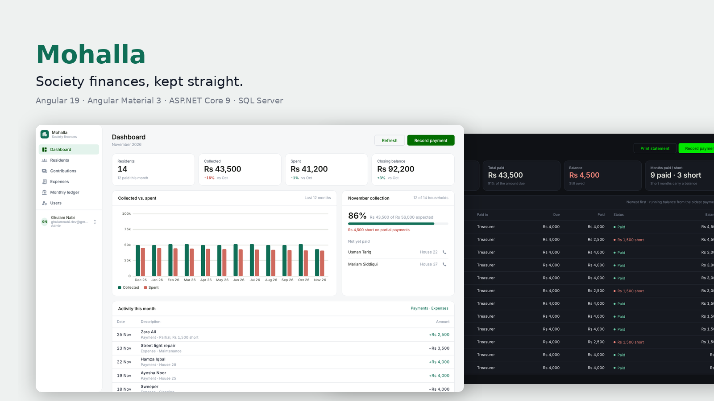

# Mohalla — API

[](https://github.com/gn-4200/SocietyManagmentSystem/actions/workflows/ci.yml)


**Mohalla** (Urdu: *neighbourhood*) keeps a housing society's books. This is the REST API: residents, monthly contributions, categorised expenses, and a month-by-month ledger that is generated automatically and carries the closing balance forward.

The Angular 19 client lives in **[gn-4200/SMS](https://github.com/gn-4200/SMS)** (`mohalla-web`).

<p align="center"></p>

## What it does

- **Residents** — register households, look one up by house number before accepting a payment (`POST /api/resident/checkResident`).
- **Monthly funds** — record each resident's contribution with amount paid, outstanding balance and date; query by month or by resident.
- **Expenses** — log spending against user-defined categories; query by month and year.
- **Monthly summary (ledger)** — opening balance, total collected, total spent, closing balance. A Hangfire recurring job creates the row for a new month on the 1st; the service computes totals and rolls the previous month's closing balance into the new opening balance (including across the year boundary).
- **Auth & roles** — ASP.NET Core Identity users, JWT bearer tokens (8-hour expiry) carrying a role claim. Two roles: **Admin** (full access) and **Viewer** (read-only). The first account to register or sign in while no administrator exists becomes Admin (this also upgrades databases created before roles existed); admins promote or demote others from the Users page. Every data endpoint requires a token; every write requires Admin.
- **Reporting** — paged, filterable, sortable `search` endpoints for contributions and expenses (joined with resident/category names), and a per-resident statement with totals.
- **Validation** — data annotations on every model and DTO; failures return RFC 7807 `ValidationProblemDetails` with per-field errors; unhandled errors return `ProblemDetails`.

## Architecture

```
┌────────────┐   HTTPS/JSON    ┌───────────────────────────────────────────┐
│ Angular 19 │ ──────────────► │ ASP.NET Core 9 Web API                     │
│ (gn-4200/  │ ◄────────────── │  Controllers → Services → Repositories     │
│   SMS)     │   JWT bearer    │  Identity + JWT · Swagger · Health checks  │
└────────────┘                 └──────────────┬────────────────────────────┘
                                              │ EF Core 9
                               ┌──────────────▼────────────────────────────┐
                               │ SQL Server (app tables + Hangfire storage)│
                               └───────────────────────────────────────────┘
                               Hangfire server: "GenerateMonthlySummary" cron 5 0 1 * *
```

| Layer | Responsibility |
|---|---|
| `Controllers/` | HTTP surface only — model binding, status codes, `[Authorize]` |
| `Services/` | Business rules (balance roll-forward, totals, token issuing) |
| `Repositories/` | EF Core data access, one per aggregate |
| `Models/`, `DTO/` | Entities and request/response contracts |
| `Migrations/` | EF Core schema history |

## API

All routes are prefixed with `/api`. Everything except `/auth/*` and `/health` needs `Authorization: Bearer <token>`.

| Method | Route | Purpose |
|---|---|---|
| POST | `/auth/register` | Create user (first user = Admin), returns token + role |
| POST | `/auth/login` | Returns token + role |
| GET | `/auth/me` | Signed-in user's profile and role |
| GET | `/auth/users` · PUT `/auth/users/{id}/role` | Admin: list accounts, change a role |
| GET / POST | `/resident` | List / add residents |
| GET / PUT / DELETE | `/resident/{id}` | Single resident |
| POST | `/resident/checkResident` | Validate a house number |
| GET | `/resident/{id}/statement` | Payment history with totals |
| GET / POST | `/monthlyfund` | List / add contributions |
| GET | `/monthlyfund/search?page&pageSize&year&month&residentId&q&sort&dir` | Paged rows with resident names |
| GET | `/monthlyfund/month/{month}` · `/monthlyfund/resident/{id}` | Filtered contributions |
| PUT / DELETE | `/monthlyfund/{id}` | Edit / remove |
| GET / POST | `/monthlyexpense` | List / add expenses |
| GET | `/monthlyexpense/search?page&pageSize&year&month&categoryId&q&sort&dir` | Paged rows with category names |
| GET | `/monthlyexpense/month/{m}/year/{y}` | Expenses for a month |
| GET / POST | `/expensecategory` · `/expensecategory/{id}` | Categories CRUD |
| GET | `/monthlysummary` · `/monthlysummary/month/{m}/year/{y}` | Ledger |
| GET | `/health` | Liveness + database check |

Interactive docs: run in Development and open the root URL (Swagger UI, with a **Authorize** button for the bearer token).

## Run it

### Option A — Docker (API + SQL Server, one command)

```bash
cp .env.example .env          # set SA_PASSWORD and a 32+ char JWT_SECRET
docker compose up --build
# Swagger: http://localhost:5091   Hangfire dashboard: http://localhost:5091/hangfire
```

### Option B — local .NET SDK

Requirements: .NET 9 SDK, SQL Server (LocalDB is fine).

```bash
cd "Server/Society Management System"

# secrets never go in appsettings.json
dotnet user-secrets set "JWT:Secret" "$(openssl rand -base64 48)"
dotnet user-secrets set "ConnectionStrings:DefaultConnection" "Server=(localdb)\MSSQLLocalDB;Database=SMS;Trusted_Connection=True;TrustServerCertificate=True"

dotnet ef database update      # apply migrations
dotnet run                     # http://localhost:5091
```

Then start the client: `git clone https://github.com/gn-4200/SMS && cd SMS && npm i && ng serve`.

### Configuration

| Key | Required | Notes |
|---|---|---|
| `ConnectionStrings:DefaultConnection` | yes | SQL Server; also used by Hangfire |
| `JWT:Secret` | yes | ≥ 32 chars — the app refuses to start otherwise |
| `JWT:Issuer`, `JWT:Audience` | yes | Defaults in `appsettings.json` |
| `Cors:AllowedOrigins` | no | Array; defaults to `http://localhost:4200` |

Environment variables use `__` as the separator (`JWT__Secret`, `ConnectionStrings__DefaultConnection`).

## Tests

```bash
cd Server
dotnet test "Society Management System.Tests"
```

Integration tests boot the real API with `WebApplicationFactory` against an in-memory SQLite database (Hangfire disabled via `Hangfire:Enabled=false`, provider via `Database:Provider=Sqlite`). They cover: first-user-is-admin, viewers are read-only, role changes, validation errors, the ledger roll-forward across months, back-dated entries creating their ledger row, the resident statement, and paging/filtering.

## Engineering highlights

- **Layered, interface-driven design** — `Controllers → Services → Repositories`, every dependency behind an interface and resolved by the built-in DI container; controllers never touch EF Core.
- **Authorization, not just authentication** — ASP.NET Core Identity with Admin / Viewer roles; the role travels in the JWT and `[Authorize(Roles = …)]` guards every write.
- **Scheduled domain logic** — a Hangfire recurring job opens each month's ledger row; the same logic self-heals when a back-dated entry arrives first.
- **Contract-first errors** — data annotations on models and DTOs, RFC 7807 `ValidationProblemDetails` / `ProblemDetails` for every failure path.
- **Designed to be tested** — the database provider and background server are configurable, so the real app boots on in-memory SQLite inside `WebApplicationFactory`; the tests exercise HTTP, auth, validation and the money rules end to end.
- **Operational hygiene** — secrets via user-secrets / environment only, health endpoint, Docker Compose, CI with tests on every push.

## Engineering notes

- **Secrets are never committed.** `appsettings.json` holds empty placeholders; real values come from user-secrets or the environment and the app fails fast at startup if they're missing.
- **Middleware order** is the canonical one: HTTPS redirect → CORS → Authentication → Authorization → endpoints.
- **Build output is ignored** (`bin/`, `obj/`, `.vs/`) and CI builds from a clean checkout.
- **Hangfire** runs the monthly job inside the API process; in a multi-instance deployment move the server to a worker role so the job executes once.

### Roadmap

- [x] Role-based access (Admin / Viewer)
- [x] Integration tests with `WebApplicationFactory`
- [x] Paged, filterable list endpoints
- [ ] Deploy to Azure App Service (free tier) with a demo login
- [ ] Receipt PDF per payment

## License

MIT © Ghulam Nabi
