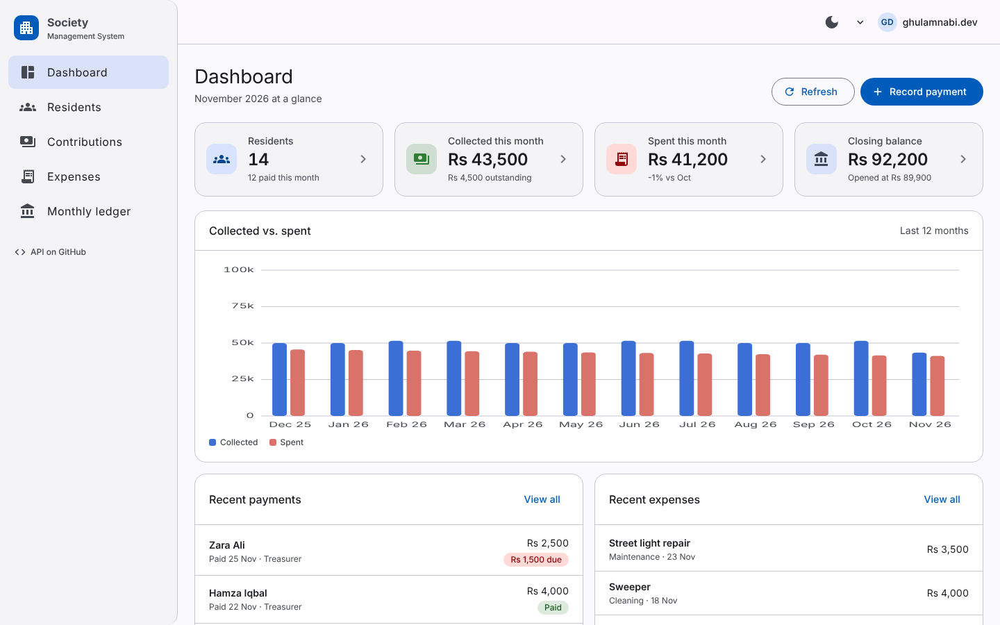
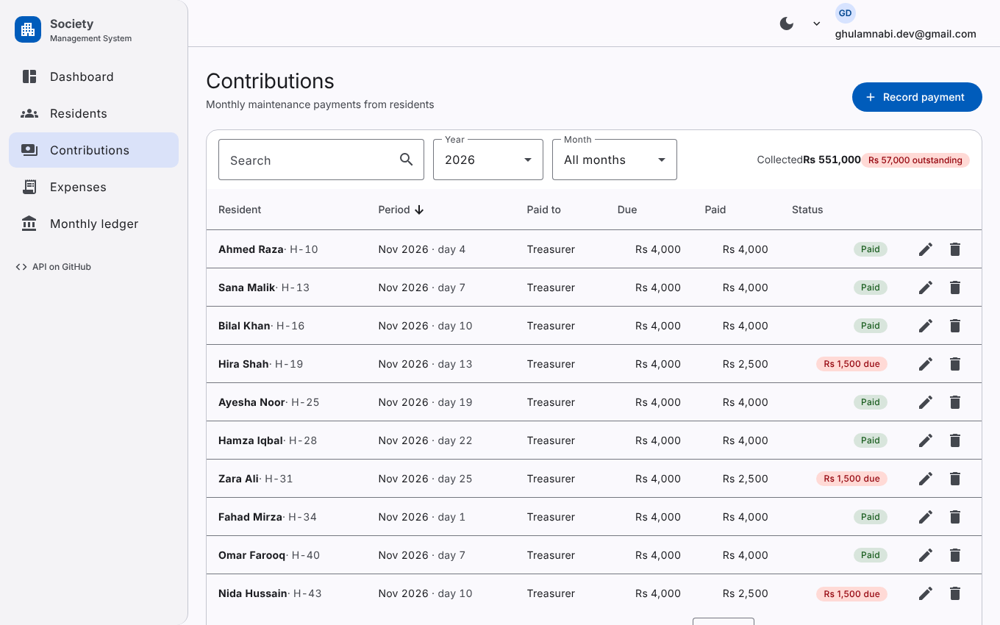
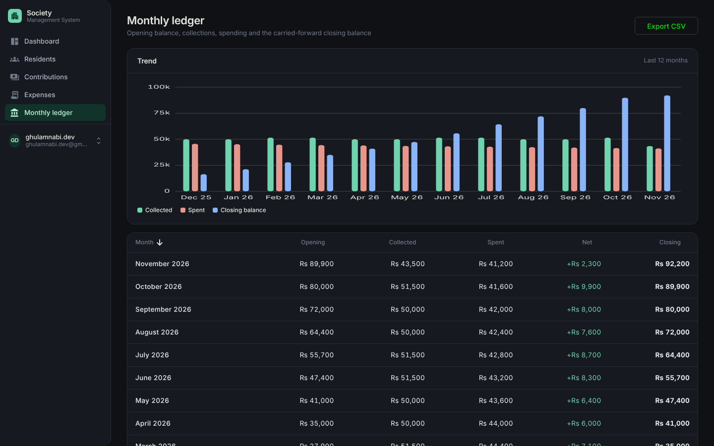
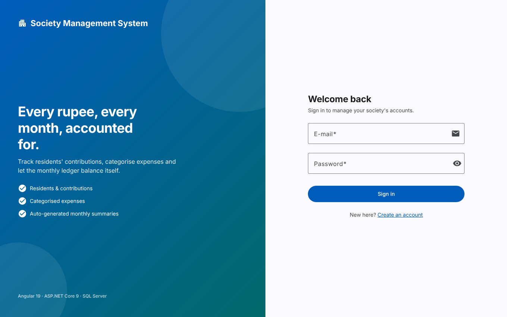
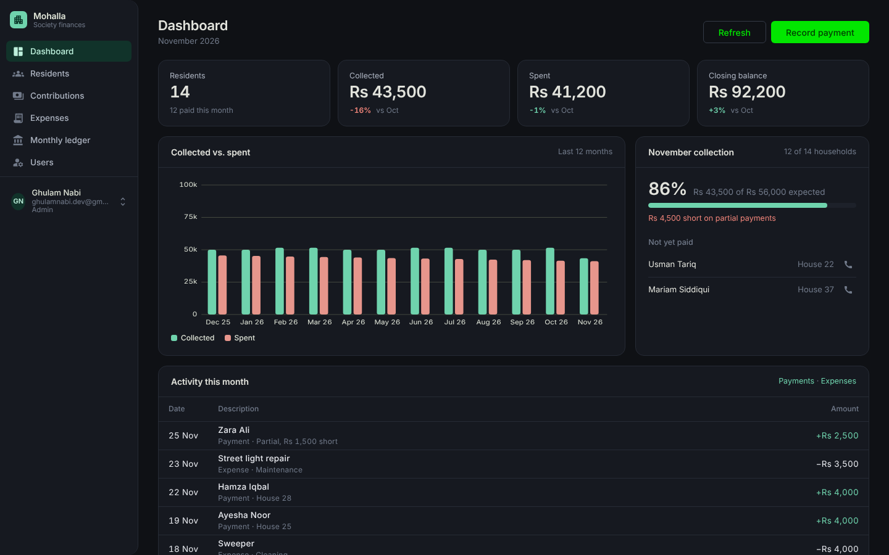
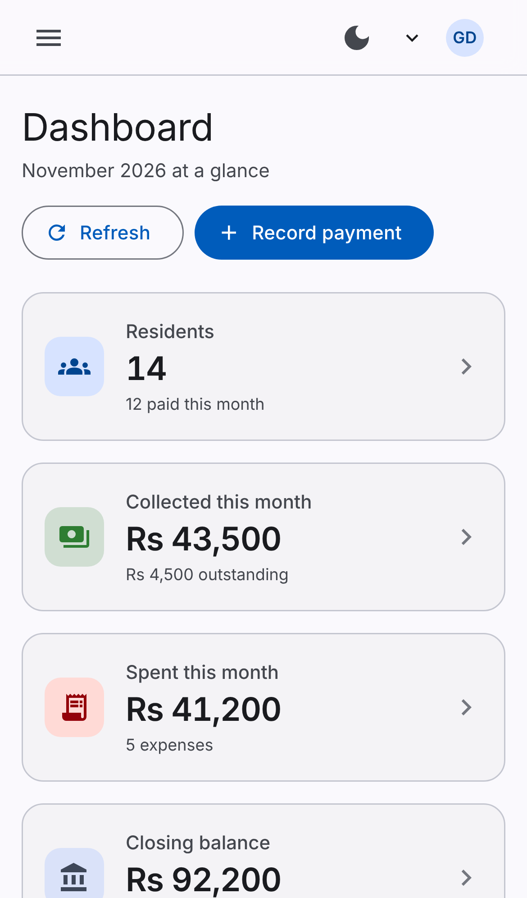

# Mohalla — Web client

[](https://github.com/gn-4200/SMS/actions/workflows/ci.yml)


**Mohalla** (Urdu: *neighbourhood*) keeps a housing society's books: residents, monthly contributions, categorised expenses and an auto-balancing monthly ledger. This is the Angular client; the ASP.NET Core 9 API lives in **[gn-4200/SocietyManagmentSystem](https://github.com/gn-4200/SocietyManagmentSystem)**.

<p align="center">
  
</p>

| Contributions | Monthly ledger |
|---|---|
|  |  |

| Sign in | Dark mode | Mobile |
|---|---|---|
|  |  |  |

## Features

- **Dashboard** — KPIs with month-over-month deltas, a 12-month collected-vs-spent chart, this month's collection progress with the households that have not paid (tap to call), and a merged activity table.
- **Residents** — searchable, sortable, paginated table; add/edit in a dialog with validation (11-digit phone).
- **Contributions** — year/month filters, running totals, paid/outstanding chips; record a payment by picking the resident and a date, outstanding computed live.
- **Expenses** — category filter, inline category management (add / rename / delete persisted to the API).
- **Monthly ledger** — opening, collected, spent, net and closing per month; trend chart; CSV export.
- **Resident statement** — a resident's full payment history with running balance, totals, and a print stylesheet; record a payment straight from it.
- **Roles** — Admin / Viewer from the JWT role claim: viewers get a read-only UI (no add/edit/delete, no actions column), admins manage accounts on the Users page. Server validation errors land on the matching form fields.
- **Auth** — JWT stored client-side, route guards (auth, guest, admin), bearer interceptor, automatic sign-out on 401, session-expiry check from the token's `exp`.
- **UI** — a quiet admin aesthetic: one accent, flat surfaces, dense tables, tabular figures; light/dark theme persisted with no flash on load; responsive to 375 px; self-hosted Inter + Material Icons; reduced-motion support.

## Stack & conventions

| | |
|---|---|
| Angular 19 | standalone components, signals, new control flow (`@if` / `@for`), lazy-loaded routes, `inject()` |
| Angular Material 19 | `mat.theme()` system tokens; `MatTableDataSource` with sort + paginator; dialogs; snack-bars |
| Forms | typed reactive forms (`nonNullable`), cross-field validators |
| HTTP | thin `CrudApi<T>` base per resource, functional interceptor |
| Charts | a 60-line SVG bar chart component — no charting dependency |
| Quality | TypeScript `strict`, `strictTemplates`, 94 unit tests (services, guards, interceptor, chart, dashboard and funds maths, statement balance), Prettier, EditorConfig, GitHub Actions |

```
src/app
├── core/          models, auth (service · guard · interceptor · token), api services, notifications, theme
├── shared/        page-header, stat-card, bar-chart, empty-state, confirm-dialog, pipes (pkr, monthName)
├── layout/        app shell: sidenav + toolbar + user menu
└── features/      auth · dashboard · residents · funds · expenses · summary (one folder per route)
```

Production bundle: **~114 kB gzipped** initial, features lazy-loaded.

## Run it

```bash
npm ci
npm start            # http://localhost:4200 — expects the API at http://localhost:5091
```

Point the client at a different API by editing `src/environments/environment.development.ts` (dev) or `environment.ts` (production builds).

Start the API with Docker from the server repo: `docker compose up --build` (see its README), or run it with the .NET SDK.

```bash
npm run seed         # demo data: 13 residents, 12 months of payments/expenses, ledger rows; creates demo@mohalla.local
```

```bash
npm test             # Karma + Jasmine, headless Chrome
npm run build:prod   # outputs dist/mohalla-web/browser — deploy as static files (Vercel, Netlify, GitHub Pages, nginx)
```

## Roadmap

- [x] Resident statement page
- [x] Role-based UI (Admin / Viewer)
- [ ] Server-side paging for the contributions and expenses tables
- [ ] E2E smoke tests with Playwright
- [ ] Deploy a demo with seeded data

## License

MIT © Ghulam Nabi
